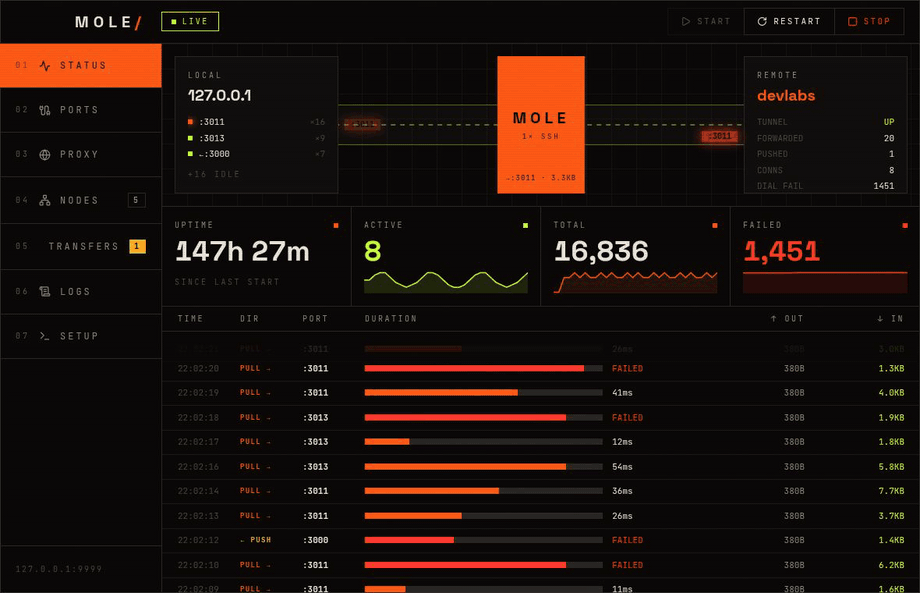
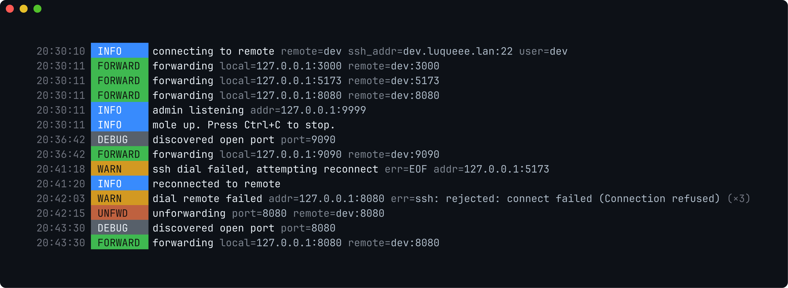
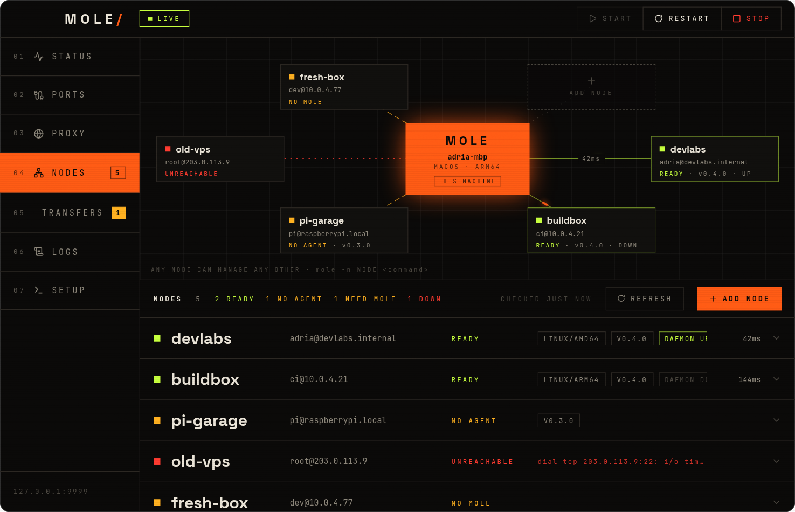

<div align="center">

#  mole

**Hit `localhost:3000` as if it were always running — even when the real service lives on another machine.**

[](https://go.dev)
[](#-platforms)
[](#-install)
[](#-license)



</div>

---

`mole` opens **one** SSH connection to a remote host and forwards local TCP
ports through it to the same ports on the remote. With auto-discovery, it
checks the remote's TCP listeners or probes a configured port list when
listener enumeration is unavailable. Run it in the background to pick up new
dev servers as they start.

```
┌────────────┐      one SSH connection        ┌────────────────────┐
│  browser   │ ──►  localhost:3000  ──►──────►│  workstation:3000  │
│  curl      │ ──►  localhost:5173  ──►──────►│  workstation:5173  │
│  whatever  │ ──►  localhost:8080  ──►──────►│  workstation:8080  │
└────────────┘             ▲                  └────────────────────┘
                           │  mole runs here, on your laptop
```

## ✨ Features

| | |
|---|---|
| 🔌 **One connection** | A single SSH client multiplexes every forwarded port. |
| 🔭 **Smart auto-discover** | Enumerates the remote's TCP listeners with `ss` or `netstat`; if neither works, probes `discover_ports`. Re-scans every 15s to pick up new servers. |
| 🧭 **SSH config aliases** | A `remote` like `dev` is resolved through `~/.ssh/config` (`ssh -G`): HostName, User, Port, IdentityFile, IdentitiesOnly, ProxyJump, known-hosts settings, Include, Match — all honoured. |
| 🛡️ **Exclude list** | System/reserved ports (22, 25, 53, 111, 631) are skipped by default; fully configurable. |
| ♻️ **Auto-reconnect** | Transparent reconnect on tunnel drop, with periodic health checks. |
| 🔑 **Native auth** | Configured `IdentityFile` keys, then ssh-agent (Unix socket / Windows named pipe), then `~/.ssh/id_*` keys. |
| 📨 **Send files** | `mole send` puts files in the other machine's inbox, from either side, over the same SSH connection; a picker lists the folder when you name nothing. Interrupted transfers resume where they stopped. |
| 📥 **Fetch files** | `mole get NODE:/path` downloads a file from any machine you can SSH into: nothing of mole needed there, checksum-verified, resumable. |
| 🕸️ **Manage other machines** | Register nodes with `mole node add`, then run any mole command on one with `mole -n NODE <command>`: its ports, pushes, inbox, status, update. Any machine can manage any other it can reach over SSH. |
| 🌙 **Background daemon** | `mole up -d` detaches; `mole down` stops it; `mole status` and `mole logs` introspect it; `mole service install` starts it at login. |
| 🎨 **Beautiful logs** | `mole logs` renders the daemon log with colour level badges, a green `FORWARD` badge, and `(×N)` collapsing of repeats. |
| 📦 **Single binary** | No separate runtime or `node_modules`; daemon mode uses the same executable. |

## 🎨 Beautiful logs

`mole logs` renders the daemon's structured log with coloured level badges, a
distinct green **FORWARD** badge when a port starts forwarding and a burnt-orange
**UNFWD** badge when a dead remote port is pruned, dimmed timestamps, and
`(×N)` collapsing of repeated lines:

<div align="center">
  
</div>

## 🚀 Quickstart

Install on **Windows** with PowerShell 5.1 or newer:

```powershell
irm https://raw.githubusercontent.com/Luqueee/mole/main/scripts/install.ps1 | iex
```

On **Linux, macOS, or FreeBSD**, install the latest release (it needs curl or
wget, tar, and sha256sum or shasum):

```bash
curl -fsSL https://raw.githubusercontent.com/Luqueee/mole/main/scripts/install.sh | sh
```

With **Homebrew** (macOS and Linux) there is a tap; the formula is `mole-tunnel`
because homebrew-core already has an unrelated `mole`, and the two cannot be
installed together (both provide a `mole` binary):

```bash
brew tap luqueee/mole
brew trust luqueee/mole          # Homebrew 7+ asks you to trust third-party taps
brew install mole-tunnel         # the CLI, built from the release tag
brew install --cask mole-tunnel  # the desktop app (macOS; it is not notarized, the cask lifts the quarantine flag)
```

Update a Homebrew install with `brew upgrade mole-tunnel`: `mole update` and the
desktop app leave a binary that Homebrew owns alone and say so.

Open a new terminal if needed, then start mole with an SSH `Host` alias from
your `~/.ssh/config`. On a fresh install, choose how to select ports:

```text
mole up --remote devlabs --auto-discover -d
mole logs -f
mole down
```

Replace `devlabs` with your own SSH alias. Press Ctrl+C to stop following logs;
the daemon keeps running until `mole down`.

Use `--ports 3000,5173` instead of `--auto-discover` to forward specific ports.
If `./mole.yaml` or your user-global config already sets `auto_discover: true`
or `ports:`, use the shorter command:

```text
mole up --remote devlabs -d
```

The `-d` flag starts mole in the background. Run `mole init` if you want to
create a config interactively.

## 🧰 Commands

| Command | What it does |
|---------|--------------|
| `mole up` | Start the forwarder in the foreground (add `-d` to background it). |
| `mole down` | Stop the running mole (started with `up -d`, in another terminal, or by the login service) and wait for it to exit. |
| `mole restart` | Stop and re-launch a backgrounded mole using the same config. |
| `mole service` | Start mole at login and restart it if it dies: `service install`, `service uninstall`, `service status` (macOS launchd, Linux systemd). |
| `mole status` | Query the local admin API for live stats + forwarded ports. |
| `mole logs` | Show the daemon log, colourised; `-f` to follow, `clean` to truncate it. |
| `mole ports` | Manage the auto-discover port list: `add`, `remove`/`rm`, `list`/`ls`. |
| `mole push` · `mole unpush` | Expose a local port on the remote (`ssh -R`): `push LOCAL[:REMOTE]`, `push list`, `unpush LOCAL`. |
| `mole send` (`ftp`) | Send files to the other machine's inbox; no arguments opens a file picker: `send [-to SUBFOLDER] [files...]`. |
| `mole get` | Download files from another machine over SSH: `get [-o DIR] [-no-verify] NODE:PATH...`. |
| `mole inbox` | Where received files land, and who may send: `inbox`, `path`, `set DIR`, `receive on\|off`, `mode ask\|auto`, `pending`, `accept`, `reject`. |
| `mole node` | The other machines you manage: `node add NAME TARGET`, `node ls`, `node ping NAME`, `node rm NAME`. |
| `mole -n NODE <command>` | Run any mole command on a node, as if typed there (pickers and Ctrl+C work). |
| `mole doctor` | Diagnose config, SSH, push and split DNS with the fix for each problem: `doctor [name...]`. |
| `mole domain` · `mole route` | Name remote services: `domain set NAME`, `route add NAME TARGET`, `route rm NAME`, `route ls`. See [Name remote services](#name-remote-services-proxy). |
| `mole dns` | Make the OS resolve the configured `domains:` through mole: `dns install`, `dns uninstall` (Linux and macOS, root). |
| `mole config` | `config edit` opens the active `mole.yaml` in `$VISUAL` / `$EDITOR`. |
| `mole init` | Generate a `mole.yaml` interactively (or scripted). |
| `mole clip` | Share clipboard images over HTTP, through a push forward or a private network: `clip serve`, `clip pull`. |
| `mole update` | Update in place to the latest release (`-version` pins one, `-branch` builds a branch). |
| `mole version` · `mole help` | The obvious. |

## 📦 Install

### Installers

Outside a local mole clone, the Windows installer downloads the latest release
for amd64 or arm64, checks its SHA-256, and adds the install directory to your
user `PATH`. It needs PowerShell 5.1 or newer, but no Go or Git:

```powershell
irm https://raw.githubusercontent.com/Luqueee/mole/main/scripts/install.ps1 | iex
```

Outside a local mole clone, the Unix installer downloads the latest release's
archive for your OS and CPU (amd64 or arm64) and checks it against the
release's `SHA256SUMS` before installing it. It needs curl or wget, tar, and
sha256sum or shasum, but no Go or Git:

```bash
curl -fsSL https://raw.githubusercontent.com/Luqueee/mole/main/scripts/install.sh | sh
```

When the GitHub CLI (`gh`) is installed and signed in, the Unix installer also
checks the archive's build provenance with `gh attestation verify`; set
`MOLE_ATTESTATION=require` to refuse an archive it cannot verify, or `off` to
skip the check. `GITHUB_TOKEN`, when set, is sent to the GitHub API to look up
the latest release (useful on shared CI runners).

| Platform | Default binary location |
|----------|-------------------------|
| Windows | `%LOCALAPPDATA%\Programs\mole\mole.exe` |
| Linux, macOS, FreeBSD (user) | `~/.local/bin/mole` |
| Linux, macOS, FreeBSD (root) | `/usr/local/bin/mole` |

Open a new PowerShell session to use the updated user `PATH`. On Unix, the
installer prints a `PATH` hint when needed.

To install from a local clone, run `./scripts/install.sh` on Unix or
`.\scripts\install.ps1` in PowerShell; both build from source. Source builds
need Git and Go 1.26.10+; the Unix installer downloads that Go into
`~/.cache/mole/go` when yours is missing or older (`MOLE_NO_GO_DOWNLOAD=1`
refuses to). The Unix installer also builds from source when `MOLE_VERSION` is
a branch or another ref that is not a `vX.Y.Z` release, when `MOLE_REPO` points
at another remote, and on a platform the releases have no archive for (it says
why). You can also download a
[prebuilt archive](https://github.com/Luqueee/mole/releases) for any
supported platform and check it against the release's `SHA256SUMS`.

Custom destinations and version pins:

```bash
./scripts/install.sh --prefix /opt              # /opt/bin/mole
INSTALL_DIR=~/bin/mole ./scripts/install.sh      # exact binary path
curl -fsSL https://raw.githubusercontent.com/Luqueee/mole/main/scripts/install.sh | MOLE_VERSION=v0.6.1 sh   # a release
curl -fsSL https://raw.githubusercontent.com/Luqueee/mole/main/scripts/install.sh | MOLE_VERSION=main sh     # build main
```

```powershell
.\scripts\install.ps1 -InstallDir 'C:\Tools\mole' # from a clone; requires Go
```

Outside a clone, pin a published Windows release before using the one-liner:

```powershell
$env:MOLE_VERSION = 'v0.1.1'
irm https://raw.githubusercontent.com/Luqueee/mole/main/scripts/install.ps1 | iex
```

The `-InstallDir` PowerShell option accepts a directory. The `INSTALL_DIR`
environment variable accepts the full path to `mole.exe`.

### Other ways to install

With Go 1.26.10+:

```bash
go install github.com/Luqueee/mole/cmd/mole@latest
```

Add your Go `GOPATH/bin` directory to `PATH` if needed. From a clone on Unix,
`make install` builds into `$(go env GOPATH)/bin`; `PREFIX=/usr/local` and
`INSTALL_DIR=/path/to/mole` override that destination.

### Scripted setup

After installing on any platform, create a user-global config without prompts:

```text
mole init -no-prompt -remote dev -auto-discover -global
```

Use `-ports 3000,5173` instead of `-auto-discover` for an explicit list.
`mole init` also reads `MOLE_REMOTE`, `MOLE_PORTS`, `MOLE_AUTO_DISCOVER`,
`MOLE_CONFIG_PATH`, and `MOLE_GLOBAL` when their matching flags are absent.

### Build without installing

```bash
make build      # → ./dist/mole
# or: go build -trimpath -o ./mole ./cmd/mole
```

### Update

Update an installed mole in place — no manual re-clone. It re-runs the official
installer against the running binary's own location:

```bash
mole update                  # the latest release
mole update -version v0.6.1  # a given release
mole update -branch feat/x   # build and install a branch (see below)
mole update -dry-run         # print what it would run, change nothing
```

Like the installers, an update downloads the release's archive and checks its
SHA-256 before replacing anything; a mole clone in the working directory is
not built instead. On Unix it needs curl or wget, tar, and sha256sum or
shasum; Windows needs PowerShell. Only `-branch` builds from source (Git on
Unix, with Go downloaded when missing; Go on Windows). On Unix, `-version`
also takes another Git ref, which is built from source the same way. For a
`go install` setup, re-run `go install github.com/Luqueee/mole/cmd/mole@latest`
instead.

#### Try a branch

You do not need a release to test something: `-branch` builds a branch from
source and installs it over the running binary.

```bash
mole update -branch feat/mesh-nodes      # this machine
mole -n devlabs update -branch feat/x    # another node
mole version                             # mole v0.3.0 (feat/mesh-nodes@a1b2c3d)
mole update                              # back to the latest release
```

`mole version` (and `mole node ping`) show which branch and commit a binary
was built from, so you can tell what each machine runs. The installer fetched
is the one **that branch** carries, so a branch can change the installer too.
A branch that does not exist is an error, never a silent install of something else.
On Windows `-branch` downloads the branch's source and builds it, so it needs
Go (releases do not). Without the CLI:

```bash
curl -fsSL https://raw.githubusercontent.com/Luqueee/mole/refs/heads/feat/x/scripts/install.sh | MOLE_VERSION=feat/x sh
```

`MOLE_REPO` points the installer at a fork (or a local repository), and
`MOLE_RAW_URL` at another place to fetch the installers from.

### Uninstall

```bash
./scripts/uninstall.sh         # Unix
./scripts/uninstall.sh --purge # also remove the user config
```

`uninstall.sh` also stops and removes the login service `mole service install`
set up (with `mole service uninstall` when the installed mole has it, else with
`launchctl` / `systemctl --user` directly); run through `sudo`, it removes the
service of the user who ran `sudo`. On Windows, run `.\scripts\uninstall.ps1` from a clone. For a `go install`
setup, remove the binary from `$(go env GOPATH)/bin`.

## 🛠️ Usage

### Foreground vs background

```bash
mole up                 # foreground (Ctrl+C to stop) — great for debugging
mole up -d              # background daemon — returns your shell
mole down               # stop the daemon
```

One mole runs per user: a second `mole up` (with or without `-d`) is refused
while one is running. The running mole holds a lock in the state directory for
its whole life, so a stale pidfile left by a crash or a reboot can never make
`mole down` signal an unrelated process that reused the PID. `mole down` waits
up to 5 seconds for mole to exit and says so if it is still running.

If the remote can't be reached when mole starts — no network yet, DNS not
ready, connection refused — mole keeps retrying (1s, 2s, 4s, … up to every 30s)
instead of exiting; Ctrl+C or `mole down` stop it at any point. Meanwhile
`mole status` reports `"state": "connecting"` (the desktop app: CONNECTING).
Problems a retry can't fix (authentication, host keys, no SSH keys, an invalid
remote) still exit with an error at once.

### Start at login (`mole service`)

```bash
mole service install            # start at login, restart if it dies
mole service install -dry-run   # print the service file and commands only
mole service status             # installed? running?
mole service uninstall          # stop it and remove the service
```

`install` registers mole with the system's service manager, running
`mole up -config <absolute path>` in the foreground with the absolute path of
the `mole` binary. `-config` picks the config (default: `./mole.yaml`, then
the user-global one — the same lookup as `mole up`); it must set `remote:`.

| Platform | Service | Output |
|----------|---------|--------|
| macOS | launchd user agent `~/Library/LaunchAgents/dev.luqueee.mole.plist` (`launchctl bootstrap gui/$UID`) | the daemon log (`mole logs`) |
| Linux | systemd user unit `~/.config/systemd/user/mole.service` (`systemctl --user enable` + `restart`) | the daemon log (`mole logs`) |
| Windows, FreeBSD | not supported yet — run `mole up -d` from a logon script instead | |

The service manager restarts mole when it crashes or exits with an error; a
clean stop is respected. So `mole down` stops a supervised mole until the next
login (it prints a reminder), and `mole restart` restarts it through the
service manager so it stays supervised. A mole already running when you
install is stopped so the service can take over.

On Linux, user services run only while you are logged in: on a headless
machine run `loginctl enable-linger $USER` so mole starts at boot. The service
sees ssh-agent only if the systemd user manager has `SSH_AUTH_SOCK` (check
`systemctl --user show-environment`); otherwise it uses `~/.ssh/id_*` keys.

### Pick the remote

The `remote` can be an explicit target **or an SSH config Host alias**:

```bash
mole up --remote dev@workstation     # explicit user@host[:port]
mole up --remote dev                 # alias from ~/.ssh/config (resolved via ssh -G)
```

For aliases, Mole honours `IdentityAgent` from the effective `ssh -G` config
for the destination and each `ProxyJump` host. A configured socket takes
precedence over `SSH_AUTH_SOCK`, so a desktop launch does not need to inherit
the terminal's environment. Socket paths support `~/` and environment-variable
expansion; `IdentityAgent SSH_AUTH_SOCK` explicitly uses that variable, and
`IdentityAgent none` disables agent authentication without disabling key files.
Without the directive, the existing environment/platform agent default applies.
The selected agent must already be running with the appropriate keys loaded.

Keys are offered in the order configured `IdentityFile` entries, agent keys,
then `~/.ssh/id_*` files, each key once; `IdentitiesOnly yes` limits this to the
`IdentityFile` keys (an agent copy of one of them still counts). Mole cannot
ask for passphrases, so a passphrase-protected key is skipped with a warning
unless it is loaded in the agent (`ssh-add`).

Host keys follow the alias's `UserKnownHostsFile` and `GlobalKnownHostsFile`
(every listed file that exists is checked; new keys go to the first user
file), `HostKeyAlias` and `HashKnownHosts`. `StrictHostKeyChecking yes`
refuses hosts that are not recorded yet; any other value trusts them on first
use. `ProxyCommand` and `CertificateFile` are not supported: mole logs a warning
and connects directly with plain keys. Use `ProxyJump` for SSH hops.

### Pick the ports

```bash
mole up --remote dev --auto-discover           # forward whatever's listening on the remote
mole up --remote dev --ports 3000,5173,8080    # forward an explicit set
```

With `--auto-discover`, mole lists the remote's TCP listeners (`ss` on Linux;
`netstat` on macOS, the BSDs and Windows OpenSSH hosts) and forwards those
reachable through remote loopback, excluding `exclude_ports`. If no command
works, or none prints a listener table mole can read, it probes only the ports
in `discover_ports` and never unforwards on a guess. It repeats discovery every
15 seconds, so a new server can be forwarded without a restart.

Listing finds everything that listens, including databases and the high
ephemeral ports that editors and language servers open. To auto-forward only
part of it, set a range:

```yaml
discover_range: "1024-49151"   # LO-HI, inclusive; unset forwards every listener
```

The range only filters listeners mole finds by itself. Ports in `ports:` and
`discover_ports:` (the built-in list included, and ports `mole ports add`
writes) are forwarded regardless, and the `discover_ports` probe fallback is
not filtered. `exclude_ports` still applies to everything except `ports:`.

### Config file

Drop a `mole.yaml` in your project (or generate it with `mole init`):

```yaml
remote: dev                    # user@host[:port] or an ssh config alias
auto_discover: true
exclude_ports: [22, 25, 53, 111, 631]   # never auto-forwarded; [] excludes nothing
admin_addr: 127.0.0.1:9999
log_level: info
```

`mole up` looks for `./mole.yaml` first, then the user-global config:
`~/.config/mole/config.yaml` on Unix or `%APPDATA%\mole\config.yaml` on Windows.
`mole init -global` writes to that user-global location.

### Inspect a running daemon

```bash
mole status        # JSON: uptime, connections, and the live forwarded-port set
mole logs          # pretty, colourised log (last 200 lines)
mole logs -f       # follow, like tail -f
mole logs -n 50 --no-dedup
```

`mole status` needs the admin API to be on. It's **off by default** — set
`admin_addr: 127.0.0.1:9999` in the config (`mole init` writes it for you) or
pass `mole up -admin 127.0.0.1:9999`. `mole status` reads `admin_addr` from the
same config as `mole up` (`-config PATH`, else `./mole.yaml`, else the
user-global config); pass `-admin ADDR` to query another address.

The admin API answers as soon as `mole up` starts, also while the first SSH
connection is still being retried: `info.state` in `/status` is `"connecting"`
until the connection is up and `"connected"` from then on. While connecting,
nothing is forwarded yet and what needs the tunnel (`mole ports add`,
`mole push`, `mole route`, `mole send`, receiving files) answers
`503 Service Unavailable` saying so.

The admin API has no authentication, so it is local-only: `mole up` refuses an
`admin_addr` that is not `localhost`, `127.x.x.x` or `[::1]` (e.g. `0.0.0.0` or
a LAN address) and exits with status 1. It also refuses requests from web
browsers (an `Origin` header, a `Sec-Fetch-Site` other than `none`, or a `Host`
that is not a loopback address, which blocks DNS rebinding), and its endpoints
that take a JSON body require `Content-Type: application/json`. A `curl` from
the same machine works: `curl -s 127.0.0.1:9999/status`.

`mole logs` parses the daemon's structured log and renders it with coloured
level badges (a distinct green **FORWARD** badge for forwarded ports), a dimmed
timestamp, and collapses consecutive identical lines into one with a `(×N)`
counter. Colour auto-disables when piped or when `NO_COLOR` is set (`--color`
forces it back on).

### Restart, ports, and editing the config

```bash
mole restart                 # stop and re-launch the daemon with the same config

mole ports list              # show the auto-discover port list
mole ports add 4321          # add a discovery candidate
mole ports remove 4321       # or: mole ports rm 4321

mole config edit             # open the active mole.yaml in $VISUAL / $EDITOR
mole config edit -editor nvim

mole logs clean              # truncate the daemon log
mole logs clean -keep 200    # …keeping the last N lines
```

`mole ports` saves changes to the active config. With the admin API enabled,
it also attempts to apply them to a running daemon; otherwise restart mole to
pick up the updated list.

### Push: expose a local service on the remote

`mole up` normally *pulls* remote ports to `localhost` (`ssh -L`). `push` is the
opposite (`ssh -R`), over the same SSH connection: a service on **your machine**
becomes reachable from the **remote**.

```bash
mole push 3000:8080          # on the remote, localhost:8080 now reaches your :3000
mole push 3000              # same port on both sides
mole push list              # forwards and their state (active | failed: reason)
mole unpush 3000            # close the remote listener
```

```yaml
push:
  - local: 3000
    remote: 8080     # default: same as local
    bind: 127.0.0.1  # address on the remote (default: loopback)
```

Like `mole ports`, changes are saved to the config and applied live if the
daemon is running. Push forwards are always explicit — never auto-discovered.
They are re-opened automatically after an SSH reconnect.

### Send files between the two machines

Each machine has an **inbox**, the folder where files sent to it land
(`~/mole-inbox` by default). `mole send` puts files in the *other* machine's
inbox; you never type a destination path, only (optionally) a sub-folder of it.

```bash
mole send report.pdf              # to the remote's inbox
mole send a.txt b.txt -to docs    # into <remote inbox>/docs
mole send                         # no files: pick them from this folder
mole ftp build.tar.gz             # ftp is an alias (it is not the FTP protocol)
```

With no files, in a terminal, a multi-select lists the regular files of the
current folder (`space` selects, `ctrl+a` all, `/` filters, `enter` sends; `-a`
includes hidden files). Directories are not supported yet.

**Local to remote** needs nothing to be enabled: run it where `mole up` runs. The
daemon opens an SSH session on the remote that runs `mole recv --stdio`, so SSH
itself is the authentication and nothing is exposed. `mole` must be installed on
the remote, and recent enough to know `recv`.

**Remote to local** is opt-in, because it lets a process on the remote write
into this machine:

```bash
mole inbox receive on        # on the machine that runs mole up
mole send report.pdf         # on the remote: lands in the local inbox
```

The daemon listens on a loopback port and exposes it on the remote through a
hidden push forward (`transfer.port`, default 9977; it does not appear in
`mole push list`). A random token, readable only by your user on both machines,
must accompany every transfer, so other users on the remote cannot use the port.

Incoming transfers **wait for your answer** unless you set `mole inbox mode auto`:

```bash
mole inbox pending           # who is sending what
mole inbox accept            # or: accept 3, accept all, reject ...
```

The desktop app has a **Transfers** tab for all of this, with drag and drop, a
file chooser, progress, history, and accept/reject buttons; the tray notes
transfers that are waiting.

```yaml
transfer:
  inbox: ~/mole-inbox   # where files sent to THIS machine land (absolute or ~/)
  receive: false        # accept files sent from the remote
  accept: ask           # ask | auto
  port: 9977            # loopback port for remote-to-local transfers
  max_size_mb: 0        # cap on one incoming transfer (0 = none)
```

Files are checked with SHA-256, written under a temporary name and only then
renamed, and never overwrite: a name that exists becomes `name (1).ext`. Names
that try to leave the inbox (`../x`, absolute paths, symlinked folders) are
refused, and received files keep only the owner's permissions. Set the remote's
own inbox with `mole inbox set DIR` on the remote.

**Interrupted transfers resume.** If the connection drops mid-file, the receiver
keeps what arrived (a hidden `.mole-resume-*.part` file in the destination
folder, for files of 1 MiB or more). Run the same `mole send` again and only
the rest is sent; the SHA-256 still covers the whole file, so a damaged partial
is detected, discarded and the next attempt starts over. A file that changed
(different size or modification time) never resumes onto the old bytes, and
partials untouched for 7 days are removed. Both machines should run a mole that
knows this (an older one just sends the whole file again, as before). If you
retry within a couple of minutes of a *silent* network drop the receiver may
still be waiting on the dead connection, and that attempt starts over.

### Fetch files from another machine

`mole send` needs mole on both ends. `mole get` only needs SSH access: the other
machine must have a POSIX shell and `tail`, plus `sha256sum` (or `shasum`, or
`openssl`) to verify the download. `NODE` is a registered node (`mole node ls`),
the config's own `remote:`, any host from your `~/.ssh/config`, or `user@host`:

```bash
mole get devlabs:/var/log/syslog                 # into the current folder
mole get -o ~/backups devlabs:~/db.dump devlabs:/etc/hosts   # several, into a folder
mole get -no-verify devlabs:/srv/huge.iso        # skip the second read for the checksum
```

The download is compared with a SHA-256 computed there (`-no-verify` skips it,
which saves reading the file a second time on that machine); if the machine has no
such tool the size is still checked and `get` says the file was not verified. An
interrupted `get` keeps what arrived: run the same command again and it continues.
Like the inbox, `get` never overwrites an existing file (`name (1).ext`). It
fetches files, not folders.

### Manage other machines (nodes)

Every machine can manage the others it can reach over SSH: there is no fixed
"orchestrator". Register a node once, then run any mole command on it from
here:

```bash
mole node add devlabs devlabs          # NAME, then user@host[:port] or an ssh alias
mole node ls                           # who answers, which mole they run, daemon state
mole -n devlabs ports add 3000         # edit devlabs' own config and apply it live
mole -n devlabs push 8080
mole -n devlabs inbox mode auto
mole -n devlabs status
mole -n devlabs send                   # the file picker opens on devlabs, in your terminal
mole -n devlabs update                 # update mole on devlabs
```

The command runs there exactly as if you had typed it on that machine: its
config, its daemon, its inbox. It needs a `mole` on the node (a node without
`agent` support, i.e. older than 0.4, still works with `-n`, it is just listed
as "no agent"). Arguments are quoted, so they reach the node verbatim, and the
node's exit code is yours. Authentication is SSH's: whoever can open a shell
there can configure it, nobody else.

```yaml
nodes:
  devlabs:
    remote: devlabs            # user@host[:port] or an ssh alias
    ssh_port: 22               # optional
    bin: ~/.local/bin/mole     # optional: where mole is on the node (default: mole)
    insecure: false            # optional, UNSAFE: skip host key verification
```

Nothing changes for existing setups: with no `nodes:`, mole behaves as before,
and the config's own `remote:` also works as a node name (`mole -n <remote> ...`).
Nodes are kept in the user-global config (`mole node add` writes it when no
config exists), so any project sees them.

<div align="center">
  
</div>

The desktop app has a **Nodes** tab for all of it: a map of your machines with
the state and latency of every link, adding a node (with your `~/.ssh/config`
hosts offered as suggestions), and, per node, its daemon (start, restart, stop),
its ports and push forwards, updating mole there (or installing a branch to try
it), and a console that runs `mole -n NODE ...`. `mole node ls -json` and
`mole node ping -json NAME` print what the tab shows, for scripts. Re-register
a node with `mole node add -force NAME TARGET`.
A node that has no mole yet is offered one: `mole node install NAME [-branch B]`
(or the tab's INSTALL button, which also appears when adding a node) runs the
installer on it over SSH. The installer itself downloads Go when the machine has
none or an older one (into `~/.cache/mole/go`, checked against the published
checksum; `MOLE_NO_GO_DOWNLOAD=1` refuses to), so only `git` and `curl` or
`wget` are needed there.

### Name remote services (proxy)

Give a service on the remote a name instead of a port: `web.dev.lan` instead of
`localhost:3000`. One local proxy picks the service from the `Host` header, so
many names share one port and several names may point at the same target.

```bash
mole domain set dev.lan                  # the names live under this domain
mole route add web 3000                  # web.dev.lan   -> port 3000 on the remote
mole route add api 10.0.0.5:8080         # api.dev.lan   -> a host the remote sees
mole route add admin admin.corp          # admin.dev.lan -> a name only the remote resolves
mole route add sec https://admin.corp    # same, over TLS
mole route add lab https+insecure://lab.corp:8443   # TLS without checking the certificate
mole route add db @dockers:5432          # db.dev.lan    -> port 5432 on the node "dockers"
sudo mole dns install -config ~/.config/mole/config.yaml   # once: make the OS resolve it
```

The desktop app does all of it in the **Proxy** tab (domain, routes, a button per
machine, HTTP/HTTPS, and the DNS install through the system password dialog).

The app and CLI run as your normal user. System DNS is optional and asks for
administrator authorization only when you enable it; do not run the GUI as
root. After installing DNS, the app reloads an already-running daemon with the
user's explicit configuration.

For named routes without administrator access, use a `.localhost` domain:

```bash
mole domain set dev.localhost
mole route add web 3000
mole restart
# Open http://web.dev.localhost:7080 (or your configured route_port).
```

Localhost-only configurations need no DNS stub or system changes. Browsers
resolve the name to loopback and the proxy uses its Host header to choose the
remote service. This is an alias for an explicit route, not transparent access
to every name in a remote domain.

A **target** is where the remote reaches the service:

| Target | Meaning |
|---|---|
| `3000` | port 3000 on the remote itself |
| `host:8080` | a host the remote can see (names are resolved **by the remote**) |
| `admin.corp` | a name, on port 80; `https://admin.corp` uses TLS on 443; `:PORT` overrides |
| `@node:3000` · `@node/host:80` | the same, through another registered node (each node gets its own SSH tunnel, opened on first use) |

How it works: a DNS stub answers `*.dev.lan` routes with `127.77.0.1`; the OS is
pointed at the stub for that domain only (`sudo mole dns install`), and port 80
of that one address is redirected to the proxy (`route_port`, default `7080`).
Plain `localhost:80` is never captured. Without the install, use `.localhost`
routes with their explicit proxy port. The app does not offer OPEN links for
custom names whose required system DNS integration is missing.

- The service receives its own address as `Host` (dev servers such as Vite or
  Ollama reject names they do not know); the name you typed travels in
  `X-Forwarded-Host`.
- `https://` targets are verified against the operating system's trusted
  roots. A service whose certificate is not trusted answers `502`;
  `https+insecure://` skips the check for that one route (the app shows it as
  `UNVERIFIED`), and never for another route to the same service.
- On macOS, a route through a node on your LAN (`192.168.x.x`) needs mole to be
  allowed under System Settings > Privacy & Security > **Local Network**: the
  permission is per application, so a daemon the desktop app started can get
  `no route to host` where a terminal does not.
- Any valid domain works (`.lan` and `.test` are the safe ones). `mole domain
  set` warns about `.local` (mDNS), `.dev`/`.app` (browsers force HTTPS) and
  public domains (they would stop reaching the real site from this machine).
- Routes added with `mole route add` apply live; changing the domain or
  `route_port` needs `mole restart` and `sudo mole dns install` again.
- macOS: `dns install` writes `/etc/resolver/DOMAIN`, an `lo0` alias for
  `127.77.0.1`, a `pf` redirect and a LaunchDaemon (`dev.mole.dns`) so it
  survives reboots; `dns uninstall` removes them, leaving other resolver files
  alone. Linux uses the `mole0` link and `nftables` described below.

### Resolve a domain on the remote (split DNS)

To reach names that only the remote can resolve (e.g. `admin.kena.lan`) from
your browser with no proxy settings:

```yaml
domains: [kena.lan]
domain_ports: [80, 443]   # optional (default)
```

```bash
sudo mole dns install     # once per machine: mole0 link + nftables + boot unit
mole up
curl https://admin.kena.lan
sudo mole dns uninstall
```

mole runs a tiny DNS stub for `*.kena.lan` (only those names — your normal DNS
is untouched), answers with a virtual `127.77.x.y` IP, and forwards connections
to it through SSH **by name**, so the remote's `sshd` does the real DNS
resolution. nftables redirects the domain ports to unprivileged listeners, so
mole coexists with local servers already owning `:80`/`:443`. Requires Linux
with `systemd-resolved` and `nft`.

### Diagnose with `mole doctor`

When something doesn't work, `mole doctor` checks the config, the SSH login,
whether the remote `sshd` allows pull *and* push forwarding, the daemon, push
forwards and the split-DNS setup, and prints a verdict per line with the fix
under each problem. Pass names to probe them end to end (remote DNS → local
resolution → TCP connect):

```text
$ mole doctor admin.kena.lan
  ❯ SSH
    ✓  connect              authenticated in 628ms
    ✓  pull forwarding      direct-tcpip channels open
    ✗  push forwarding      sshd refused the remote listener
       ↳ set `AllowTcpForwarding yes` in the remote sshd_config
```

The exit status is 1 if any check failed. It never changes anything.

### Clipboard images

`mole clip` moves clipboard **images** from the machine running `clip serve` to
the one running `clip pull` — useful for pasting a screenshot taken on your
machine into a tool that runs on the remote. Automatic clipboard watching is
available on macOS; `clip pull` works on every supported platform.

```bash
mole clip serve              # on the source Mac; watches its clipboard by default
mole clip pull               # on the target; uses clip_url from the config, or -url
```

The clip endpoint is plain HTTP with **no authentication**, and `clip serve`
binds `127.0.0.1:7777` by default. The safer way to reach it from the remote is
to keep it on loopback and carry it over mole's SSH connection with a
[push forward](#push-expose-a-local-service-on-the-remote), on the machine that
runs both `mole up` and `mole clip serve`:

```yaml
push:
  - local: 7777    # the remote's 127.0.0.1:7777 reaches this machine's clip server
```

`mole push 7777` adds the same rule from the command line. On the remote, point
`mole clip pull` at its own loopback port (in the remote's `mole.yaml`, or with
`-url`):

```yaml
clip_url: http://127.0.0.1:7777
```

While `mole up` is connected, the image travels through the SSH tunnel and the
server is never exposed on a network interface. The forwarded port is still
open to every local user of the remote, as any push forward bound to loopback is.

Without the tunnel, you can bind the server to the source machine's private
Tailscale or WireGuard address and use the same address in `clip_url`:

```yaml
clip_url: http://100.64.0.10:7777
clip_listen: 100.64.0.10:7777
```

Every host that can reach that address can then read the latest image and
upload a new one, so prefer the push forward. Binding to `0.0.0.0:7777`,
`:7777`, or `[::]:7777` is supported for controlled networks, but
`mole clip serve` emits a warning because every interface can reach the
unauthenticated endpoint.


### Generate the config with `mole init`

`mole init` ships **inside the binary** — no separate script — so the prompts
are identical on every OS and always in sync with the loader.

| Mode | When | How |
|------|------|-----|
| **Interactive** | first-time setup | `mole init` |
| **Semi-interactive** | you know the remote | `mole init -remote dev` |
| **Fully scripted** | CI, Docker, no TTY | `mole init -no-prompt -remote … [-auto-discover]` |

```text
$ mole init
configuring mole — press Enter to accept the default in [brackets]
SSH remote (user@host[:port] or ssh config alias): dev
How should mole pick ports?
  1) auto-discover common dev ports (recommended)
  2) explicit list (comma-separated)
  3) skip — I'll configure ports later
  choose [1]: 1
Where to save the config?
  1) ./mole.yaml               (current directory, project-local)
  2) ~/.config/mole/config.yaml  (user-global)
  3) don't save — print to stdout instead
  choose [1]: 2
wrote ~/.config/mole/config.yaml
Start mole now? [Y/n]: y
starting mole in the background
```

Useful `init` flags: `-global`, `-print`, `-no-prompt`, `-yes`, `-test`,
`-force`, `-up`. Environment fallbacks (read when the matching flag is empty):
`MOLE_REMOTE`, `MOLE_PORTS`, `MOLE_AUTO_DISCOVER`, `MOLE_CONFIG_PATH`,
`MOLE_GLOBAL`.

## 📖 CLI reference

```text
mole up [flags]
  -config         path to YAML config (default: ./mole.yaml, then user-global)
  -remote         SSH target (user@host[:port]) or an ssh config alias
  -ports          comma-separated ports to forward (e.g. 3000,5173)
  -auto-discover  forward whatever is listening on the remote
  -admin          admin HTTP address, loopback only; overrides admin_addr
  -log-level      debug|info|warn|error
  -insecure       disable SSH host key verification (UNSAFE; dev only)
  -d, -detach     run in the background; stop with 'mole down'

mole down
mole restart [-config PATH]
mole service install|uninstall|status [-config PATH] [-dry-run]
mole status  [-config PATH] [-admin ADDR]
mole logs    [-f] [-n N] [-raw] [-color] [-no-color] [-no-dedup]
mole logs clean [-keep N]
mole ports  add [-config PATH] <port>
mole ports  remove|rm [-config PATH] <port>
mole ports  list|ls [-config PATH]
mole push   [-config PATH] [-bind ADDR] LOCAL[:REMOTE]
mole push   list|ls [-config PATH]
mole unpush [-config PATH] LOCAL
mole send   [-config PATH] [-to SUBFOLDER] [-a] [-direct] [files...]    (alias: ftp)
mole get    [-config PATH] [-o DIR] [-no-verify] NODE:PATH...
mole inbox  [path | set DIR | receive on|off | mode ask|auto | pending | accept [ID|all] | reject [ID|all]] [-config PATH]
mole -n NODE <command> [args...]                 run a mole command on a node
mole node   install NAME [-branch B]
mole node   add NAME TARGET [-ssh-port N] [-bin PATH] [-insecure] [-no-check] [-force] [-config PATH]
mole node   ls [-json]|ping [-json] NAME|rm NAME [-config PATH]
mole domain set NAME | show [-config PATH]
mole route  add NAME TARGET | rm NAME | ls [-config PATH]
mole dns    install|uninstall -config PATH        (Linux and macOS, needs root)
mole doctor [-config PATH] [-timeout 10s] [name...]
mole config edit [-config PATH] [-editor CMD]
mole init   [flags]
mole clip   serve [-listen 127.0.0.1:7777] [-watch] [-config PATH] [-log-level L]
mole clip   pull  [-url URL] [-config PATH] [-log-level L]
mole update [-version REF] [-dry-run] [-no-verify]
mole version · mole help
```

## ⚙️ Config reference

| Field            | Type   | Default              | Notes                                              |
|------------------|--------|----------------------|----------------------------------------------------|
| `remote`         | string | —                    | `user@host[:port]` **or** an ssh config alias (required) |
| `ports`          | int[]  | `[]`                 | Explicit ports — always forwarded                  |
| `auto_discover`  | bool   | `false`              | Forward the remote's live listeners                |
| `discover_ports` | int[]  | see below            | Fallback probe list when `ss`/`netstat` are absent |
| `discover_range` | string | `""` (no filter)     | Only auto-forward enumerated listeners in `LO-HI` (e.g. `"1024-49151"`); `ports`/`discover_ports` are not filtered |
| `exclude_ports`  | int[]  | `[22,25,53,111,631]` | Never auto-forwarded; `[]` excludes nothing        |
| `admin_addr`     | string | `""` (disabled)      | Admin HTTP address, loopback only (`localhost`, `127.x.x.x`, `[::1]`); `mole init` writes `127.0.0.1:9999`. Required by `mole status` |
| `log_level`      | string | `info`               | `debug`, `info`, `warn`, `error`                   |
| `ssh_port`       | int    | `22`                 | SSH port on the remote                             |
| `insecure`       | bool   | `false`              | Disable SSH host key verification (UNSAFE; dev only) |
| `clip_url`       | string | —                    | Clip server URL used by `mole clip pull`           |
| `clip_listen`    | string | `127.0.0.1:7777`     | Bind address of `mole clip serve`; keep loopback and reach it with a push forward |
| `clip_interval_ms` | int  | —                    | Clipboard poll interval for `clip serve -watch`    |
| `push`           | rule[] | `[]`                 | Local services exposed on the remote (`local`, optional `remote`, optional `bind`; default bind `127.0.0.1`) |
| `transfer`       | object | see [Send files](#send-files-between-the-two-machines) | `inbox`, `receive`, `accept`, `port`, `max_size_mb` |
| `nodes`          | map    | `{}`                 | Other machines to manage (`remote`, optional `ssh_port`, `bin`, `insecure`); see [Manage other machines](#manage-other-machines-nodes) |
| `domains`        | string[] | `[]`               | DNS suffixes (e.g. `kena.lan`); transparent remote resolution needs system DNS, while `.localhost` named routes work without it |
| `domain_ports`   | int[]  | `[80,443]`           | Ports forwarded for every name under `domains` (1–45535) |
| `routes`         | map    | `{}`                 | Named services: `NAME: TARGET` (`3000`, `host:port`, `admin.corp`, `https://…`, `@node:port`); see [Name remote services](#name-remote-services-proxy) |
| `route_port`     | int    | `7080`               | Local port of the route proxy (1024–65535); `dns install` redirects port 80 to it |

Fallback `discover_ports`:

```
3000 3001 3002 3003 3004 3005
4200 5173 5174 5327
6006 8000 8080 8081 8443 9000 9090
```

## 🔬 How it works

1. Open **one** SSH client connection to the remote (ssh-agent or `~/.ssh/id_*`
   keys; aliases resolved via `ssh -G`).
2. Discover ports: enumerate the remote's TCP listeners (`ss`/`netstat`), or
   fall back to probing `discover_ports`. Skip `exclude_ports` and, if set,
   listeners outside `discover_range`.
3. For each port, bind `127.0.0.1:<port>` locally; on a local connection, dial
   `127.0.0.1:<port>` through the tunnel and bridge bytes both ways.
4. Re-discover every 15s and forward anything new; a watchdog goroutine
   reconnects the SSH session if it dies.

State (pidfile, instance lock `mole.lock`, background log) lives in
`~/.local/state/mole/` on Unix (honouring `XDG_STATE_HOME`) and
`%LOCALAPPDATA%\mole\` on Windows.

## 💻 Platforms

Single static Go binary — **Linux**, **macOS**, **Windows**, **FreeBSD** (amd64 & arm64).
SSH auth is native per platform:

- **Linux / macOS / BSD** — ssh-agent over a Unix socket (`SSH_AUTH_SOCK`).
- **Windows** — ssh-agent over the OpenSSH named pipe
  (`\\.\pipe\openssh-ssh-agent`).

## ⚠️ Limitations

- **Host keys are verified** against `~/.ssh/known_hosts` (or the known-hosts
  files an alias's ssh_config selects). Unknown hosts are trusted on first use
  (recorded automatically, like OpenSSH) unless `StrictHostKeyChecking yes` is
  set; a later key *mismatch* is always refused as a possible MITM. Pass `--insecure` (or
  `insecure: true`) to turn verification off for throwaway dev hosts.
- **Dead ports are pruned only under auto-discover** — when `ss`/`netstat` can be
  enumerated, a remote service that stops has its local listener closed (you'll
  see an `UNFWD` line). Explicitly configured `ports:` are pinned and never
  pruned, and when enumeration isn't available mole only adds, never removes.
- **TCP only** — no UDP forwarding yet.
- **Pageant** (PuTTY's Windows agent) isn't supported — OpenSSH agent only.
- **Push forwards need `AllowTcpForwarding`** on the remote `sshd` (on by
  default). They bind `127.0.0.1` on the remote unless `bind:` says otherwise;
  exposing them beyond that needs `GatewayPorts` on the remote — mole never
  enables it. A bind failure is reported once and shown as `failed` in
  `mole push list` / `mole status`; it is retried after each reconnect.
- **Forwarding by name (`domains:` without a route) is Linux-only**
  (systemd-resolved + nftables, one `sudo mole dns install` per machine);
  named **routes** also work on macOS. Browsers with their own DNS-over-HTTPS
  bypass both.
  Every configured domain port must be free of conflicts on the virtual IPs;
  a name whose port can't be bound answers `SERVFAIL` rather than being
  published half-working.

## 🧑‍💻 Development

```bash
make build      # → ./dist/mole
make install    # build + install (PREFIX=/usr/local or INSTALL_DIR=… to override)
make run        # build, then run `mole up`
make test       # go test ./...
make tidy
make uninstall
make clean
```

CI (`.github/workflows/ci-cd.yml`) runs on every pull request and on `main`:
`go vet` and `go test -race` on Linux and macOS, tests and the installers on
Windows, staticcheck and govulncheck for every supported OS, actionlint, the
landing checks, and — on macOS — the desktop module's vet, race tests,
staticcheck and govulncheck plus its frontend typecheck. The Go version comes from the `go`
directive in `go.mod` and `desktop/go.mod`. The same analysis locally:

```bash
go run honnef.co/go/tools/cmd/staticcheck@v0.8.2 ./...
go run golang.org/x/vuln/cmd/govulncheck@v1.9.0 ./...
# the desktop module embeds desktop/frontend/dist, so build the frontend first
(cd desktop/frontend && npm ci && npm run build) && (cd desktop && go test ./...)
```

### Releasing

CLI releases are built and published by `.github/workflows/release.yml` when a
`v*` tag is pushed:

1. Bump `const version` in `cmd/mole/main.go` and merge it to `main`.
2. Tag that commit and push the tag: `git tag v0.9.0 && git push origin v0.9.0`.
3. The workflow runs the tests, builds the archives with
   `scripts/release-archives.sh` (it refuses a version that `main.go` does not
   carry), attests their build provenance, and creates the GitHub release with
   every `mole_<version>_<os>_<arch>` archive and `SHA256SUMS`, notes generated
   since the previous `v*` tag. It is marked as the latest release, which is
   what the installers download.

To check a downloaded archive:

```bash
sha256sum --ignore-missing -c SHA256SUMS
gh attestation verify mole_0.9.0_linux_amd64.tar.gz --repo Luqueee/mole
```

The desktop app is released separately from `desktop-v*` tags by
`.github/workflows/desktop-bundles.yml`; those releases are never marked latest.

## 📄 License

MIT.
